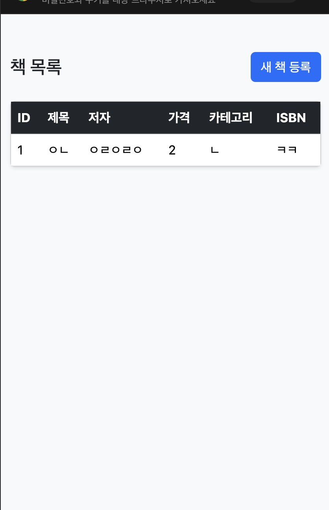
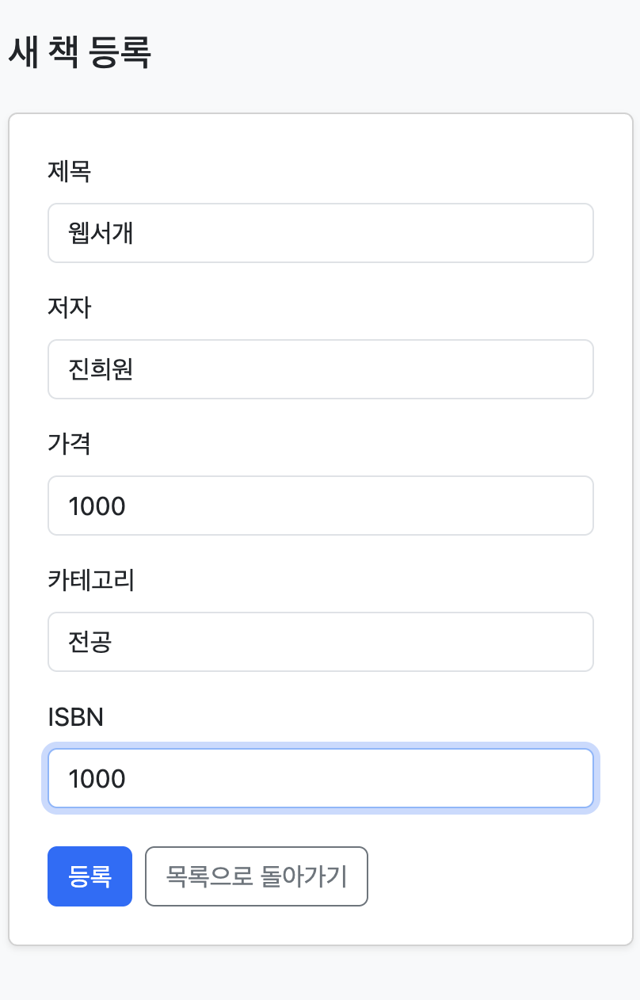
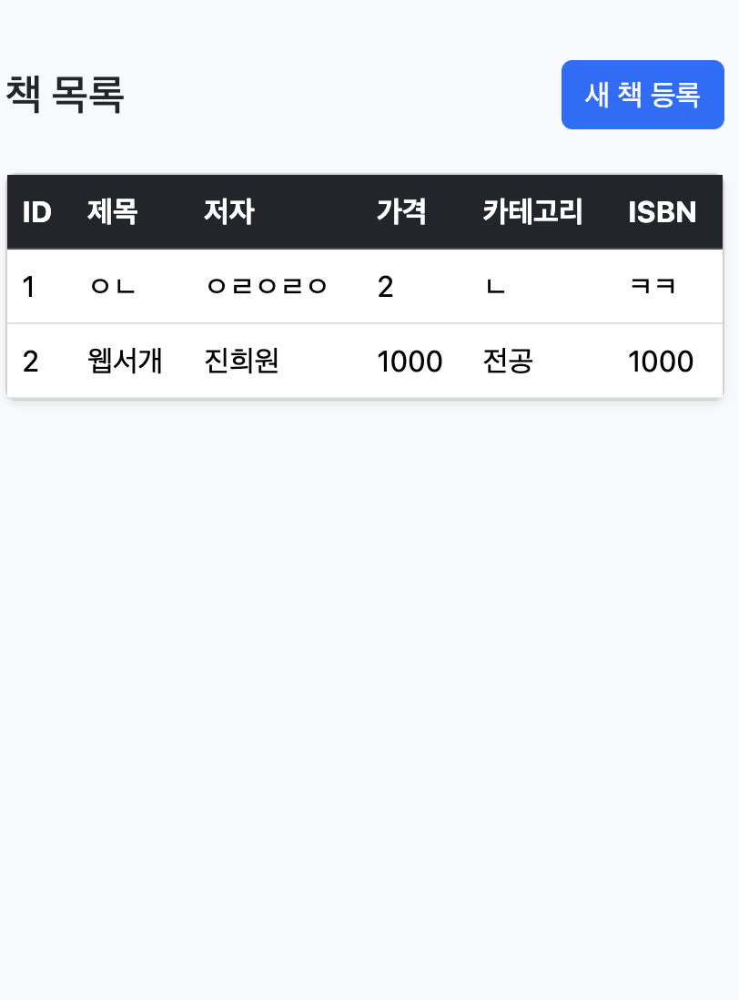

# Book Web UI

Spring Boot와 Thymeleaf로 구현한 메모리 기반 책 관리 웹 애플리케이션입니다. 책 목록을 확인하고 HTML Form으로 새 책을 등록합니다. 데이터베이스 대신 `Map<Long, Book>`에 데이터를 저장합니다.

- 과제 저장소: https://github.com/2026-2-WebService/assign06-c01-22300743
- 개인 저장소: https://github.com/JinHeeWond/week6_webservice
- Render 배포 URL: https://week6-webservice-22300743.onrender.com/books
- [Weekly Report](docs/weekly-report.md)

## 기술 및 데이터

Java 17, Gradle Wrapper, Spring Boot 4.1.1, Spring MVC, Thymeleaf, Bootstrap 5.3.8을 사용합니다.

| 필드 | 타입 | 의미 |
| --- | --- | --- |
| id | Long | 저장 시 부여되는 ID |
| title | String | 제목 |
| author | String | 저자 |
| price | int | 가격 |
| category | String | 카테고리 |
| isbn | String | ISBN |

서버를 재시작하면 메모리에 저장된 책 데이터는 초기화됩니다.

## 프로젝트 구조

```text
src/main/java/org/example/webui/bookwebui/
├── BookWebUiApplication.java
├── controller/BookWebController.java
├── service/BookService.java
├── repository/
│   ├── BookRepository.java
│   └── MemoryBookRepository.java
├── domain/Book.java
└── dto/BookRequest.java
src/main/resources/
├── application.properties
├── templates/books/
│   ├── list.html
│   └── form.html
└── static/css/style.css
src/test/java/org/example/webui/bookwebui/
├── BookWebUiApplicationTests.java
└── BookWebFlowTests.java
```

## 실행 방법

JDK 17을 설치한 환경에서 프로젝트 루트의 Gradle Wrapper로 실행합니다.

```bash
./gradlew bootRun
```

Windows에서는 `gradlew.bat bootRun`을 사용합니다. IntelliJ에서는 `BookWebUiApplication`의 `main` 메서드를 실행할 수 있습니다.

- 목록: http://localhost:8081/books
- 등록: http://localhost:8081/books/new

8080 포트 충돌을 해결하기 위해 기본 포트를 8081로 설정했습니다. 이미 실행 중인 앱이 8081을 사용한다면 해당 실행을 종료한 뒤 다시 실행합니다. 임시로 포트를 변경하려면 다음 명령을 사용합니다.

```bash
./gradlew bootRun --args='--server.port=8082'
```

## Web Endpoint

| HTTP Method | URL | 기능 | 결과 |
| --- | --- | --- | --- |
| GET | /books | 전체 책 목록 조회 | books/list |
| GET | /books/new | 책 등록 Form 조회 | books/form |
| POST | /books | 책 등록 | redirect:/books |

## 주요 화면

목록 화면은 ID, 제목, 저자, 가격, 카테고리, ISBN을 표로 표시합니다. 등록된 책이 없으면 안내 문구를 표시하며, 새 책 등록 버튼으로 등록 화면에 이동합니다.

등록 화면에는 제목, 저자, 가격, 카테고리, ISBN 입력란과 등록 버튼, 목록으로 돌아가기 버튼이 있습니다. Form은 `POST /books`로 전송합니다.

### 등록 전 목록



### 책 등록 Form



### 등록 후 목록



등록 Form에 입력한 제목 `웹서개`, 저자 `진희원`, 가격 `1000`, 카테고리 `전공`, ISBN `1000`이 등록 후 목록에 표시됩니다.

## 실행 흐름

### 목록 조회

```text
Browser → BookWebController → BookService → BookRepository
→ MemoryBookRepository → List<Book> → Model(books) → Thymeleaf → HTML
```

### 데이터 등록

```text
HTML Form → POST /books → @ModelAttribute BookRequest
→ BookService → BookRepository → Memory
→ redirect:/books → GET /books → 목록 HTML
```

등록 후 GET으로 이동하는 PRG(Post → Redirect → Get) 구조를 사용합니다. 목록 화면에서 새로고침하면 목록 조회 요청을 다시 수행합니다.

## 검증

```bash
./gradlew clean build
```

위 명령으로 전체 빌드와 자동 테스트가 통과했습니다.

- `BookWebUiApplicationTests`: Spring 애플리케이션 컨텍스트 시작 확인
- `BookWebFlowTests`: 빈 목록 렌더링, 등록 Form 렌더링, 5개 필드 등록, 목록 redirect, 등록 데이터 출력, CSS 응답 확인

배포 사이트에서 등록 버튼 클릭, 등록 후 목록 표시, 새로고침 후 중복 등록되지 않는 것을 확인했습니다. 좁은 화면에서 표와 Form 표시는 별도로 확인할 수 있습니다. 자동 테스트는 Bootstrap CDN의 실제 다운로드나 브라우저 화면 모양을 검증하지 않습니다.

## 이번 과제 키워드

`@Controller`, Thymeleaf, `Model`, `@ModelAttribute`, HTML Form, `redirect:`, PRG Pattern, Bootstrap, Layered Architecture

## 핵심 내용 정리

1. `@Controller`는 View 이름을 반환하여 HTML 화면을 렌더링하며, `@RestController`는 반환 값을 응답 본문으로 전달합니다.
2. Controller는 `model.addAttribute("books", ...)`로 데이터를 전달하고, Thymeleaf는 `th:each`와 `th:text`로 목록을 출력합니다.
3. HTML Form의 `name`과 DTO의 필드 이름을 맞추면 `@ModelAttribute`로 입력을 바인딩할 수 있습니다.
4. 등록 후 `redirect:/books`를 반환하면 POST 다음에 GET이 실행되는 PRG 흐름이 만들어집니다.
5. Controller, Service, Repository를 분리하면 HTTP 처리와 데이터 저장 책임을 나누고 Repository 인터페이스를 통해 구현을 교체할 수 있습니다.

## Render 배포 설정

`Dockerfile`로 JDK 17 환경에서 실행용 JAR을 빌드하고 실행합니다. `render.yaml`은 무료 Docker Web Service 설정입니다. Render에서 개인 GitHub 저장소의 `main` 브랜치를 연결하며, Health Check 경로는 `/books`입니다. 서버 포트는 Render의 `PORT` 환경변수를 사용하고 로컬 기본값은 8081입니다.

## 제출 전 남은 확인

- [x] 실제 목록·등록 화면 스크린샷을 README에 포함
- [x] Weekly Report 작성
- [x] Render 배포 및 배포 URL 기입
- [x] 배포 환경에서 목록·등록·새로고침 확인
- [x] 최종 코드를 GitHub에 Push하고 원격 커밋 확인
- [ ] LMS에 과제 저장소 URL과 Render URL 제출
- [ ] 정답·해설을 포함한 Weekly Question 2문제 제출
